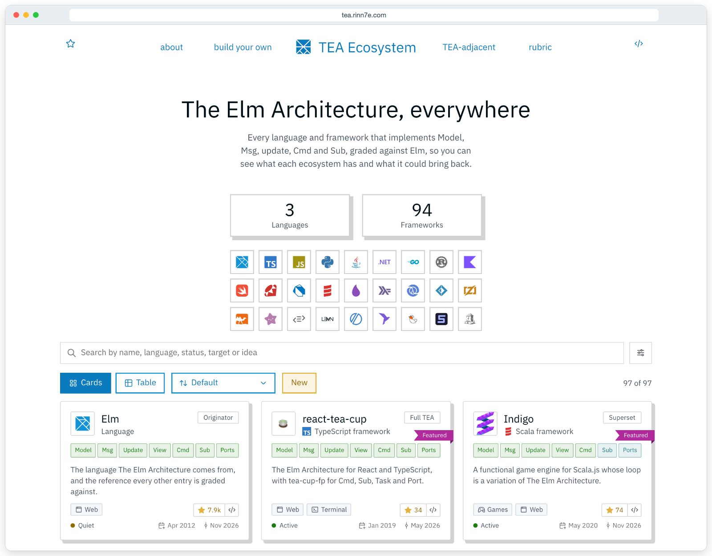

<p align="center">
  
</p>

<h1 align="center">TEA Ecosystem</h1>

<p align="center">
  <a href="https://tea.rinn7e.com/"><b>tea.rinn7e.com</b></a>
</p>

<p align="center">
  Every language and framework that implements The Elm Architecture, graded against Elm.
</p>

<p align="center">
  <a href="https://github.com/rinn7e/tea-ecosystem/actions/workflows/pages.yml"></a>
  <a href="https://tea.rinn7e.com/"></a>
  <a href="https://github.com/vankeisb/react-tea-cup"></a>
  <a href="https://github.com/sponsors/rinn7e"></a>
  <a href="LICENSE"></a>
</p>

A catalog of The Elm Architecture across languages: every language and framework that implements Model, Msg, update, Cmd and Sub, graded against Elm, so you can compare what each ecosystem has and what could come back to Elm.

<p align="center">
  
</p>

## What is on the site

| Page                 | What it shows                                                                                                                                  |
| -------------------- | ---------------------------------------------------------------------------------------------------------------------------------------------- |
| Catalog              | Every entry, as cards or as a table of grades, with search and filters (tier, target, status)                                                  |
| A page per framework | Its grade on each part of TEA, with notes, and the other entries in its languages                                                              |
| Rubric               | What counts as TEA: the four grades and the three tiers                                                                                        |
| TEA-adjacent         | Libraries that share the vocabulary but miss a hard requirement (Redux, NgRx, XState, ...), graded the same way and filtered by what they lack |
| Build your own TEA   | A runtime in eight steps, in Swift, TypeScript and Kotlin                                                                                      |

How the catalog sorts:

- By default: Elm first, then the picks of the maintainer (react-tea-cup, Indigo, Miso, each with a "Featured" ribbon), then the most starred.
- The sort menu also offers popularity, recently updated, recently created and newly added.
- The **New** button shows the newest entries first, and turns solid while it is on.
- A filter that also matches archived entries, or entries of the other list, says so and links to them. With **New** on, the list also points to the entries the other list added recently.

The bar shows the live star count of the repository on its left, and how long ago the site last changed on its right; both open the repository.

The thinking behind it is in [doc/analysis.md](doc/analysis.md).

## Stack

- React with [react-tea-cup](https://github.com/vankeisb/react-tea-cup) (The Elm Architecture for React), `tea-cup-fp`, `fp-ts` and `io-ts`
- Vite, TypeScript and Tailwind CSS v4
- Vitest, with fast-check for property tests
- Frontend only: the data is bundled at build time, and the site is static on GitHub Pages

## Run it

The `@rinn7e` packages come from GitHub Packages, so `~/.npmrc` needs a token that can read packages:

```bash
//npm.pkg.github.com/:_authToken=<token>
```

Then:

```bash
pnpm install
```

```bash
pnpm dev
```

The site runs on `http://localhost:5180`.

## Check it

```bash
pnpm run check && pnpm run lint && pnpm run format:check && pnpm run test
```

```bash
pnpm run build
```

## Add or fix a framework

Edit `data/frameworks.json`, or `data/adjacent.json` for a library that misses a hard requirement. `pnpm run test` checks that the file decodes and that every entry holds the rules of its tier.

### Fields

| Field                | Required | What it holds                                                                                                                                                       |
| -------------------- | -------- | ------------------------------------------------------------------------------------------------------------------------------------------------------------------- |
| `discoveredAt`       | yes      | When you add it, `YYYY-MM-DDTHH:MM:SSZ` in UTC. A new entry shows as "Recently added" for 30 days.                                                                  |
| `repo`               | yes      | The full URL of its public repository (GitHub, GitLab, Codeberg or another Gitea). Only when its source is not public: its website, with the same URL in `website`. |
| `website`            | no       | Its website, when it has one apart from the repository                                                                                                              |
| `source`             | no       | For one package of a monorepo: the full URL of its directory in `repo`                                                                                              |
| `logo`               | no       | A file in `public/logo/`. Without one, a monogram stands in.                                                                                                        |
| `logoOnLight`        | no       | `true` when the logo is drawn in dark ink on a transparent ground (its tile stays white in dark mode)                                                               |
| `logoPadding`        | no       | `small`, `medium` or `large`, for a logo drawn edge to edge that looks too large next to the others                                                                 |
| `unmaintainedNotice` | no       | For an entry whose author says it is no longer maintained, though its repository is not archived: where the author says so (its status is then `archived`)          |

### Grades and notes

- Each grade is `native`, `managed`, `equivalent` or `missing`. The [rubric](doc/analysis.md#3-inclusion-rubric) says what each means; `equivalent` describes a part and never qualifies a tier.
- A superset names what it adds beyond TEA in a note that starts with `Superset: `.
- A TEA-adjacent library starts its notes with the requirements it misses (`Misses Cmd and Sub: ...`).

### Stars and dates

Fill its stars, and the times its repository was created and last pushed to (in UTC, so two of one day sort newest first; the site shows only the month), with:

```bash
GITHUB_TOKEN=<token> node scripts/fetch-repo-stats.mjs
```

After that they refresh every week on their own: `.github/workflows/refresh-stats.yml` runs the same script, follows a repository that moved, and commits the data when `pnpm run test` passes. Its job summary lists what is left for a person: a status to check, a host that did not answer, a broken link, a link that redirects.

## New entries every week

Every Monday, `.github/workflows/discover.yml` runs an AI agent (`scripts/discover-agent.mjs`, on the Claude Agent SDK) that looks for TEA frameworks the catalog does not list yet, as `.github/discover-prompt.md` says.

1. It grades each candidate from its own docs and source.
2. It opens one draft pull request for the week, with three candidates at most and the evidence of each grade.
3. Only the data the agent wrote reaches the repository: the workflow checks it and makes a commit of its own of it.
4. The pull request merges on its own when every candidate passes `scripts/judge-discovered.sh`. Otherwise it stays a draft, with a comment that names the rules that failed, for a person to review and merge.

The rules of `scripts/judge-discovered.sh`:

- at least 5 stars;
- pushed to in the last year, and not archived;
- every grade verified;
- an example of at most 90 lines, with its source.

It skips what either data file lists, forks, archived, unmaintained and tiny projects, and the projects of `data/rejected.json`. While its pull request is open, the next runs skip their search and spend nothing, so two pull requests never conflict.

### Settle a pull request by hand

For a pull request opened before these rules, or one a person edited, start the workflow "Settle discovered" (`.github/workflows/settle-discovered.yml`) with its number. It runs the same checks and rules, then merges it or comments.

### See what the agent did

Open the run in the Actions tab (workflow "Discover"):

| Where                                    | What                                                                                                                                                      |
| ---------------------------------------- | --------------------------------------------------------------------------------------------------------------------------------------------------------- |
| The log of the agent step                | One line per step, live: each search, fetch, edit and command, each call denied or failed, each retry of the API, and a short line for each thing it says |
| The summary of the run                   | The report of the agent, or, when it did not finish, why and what it said last                                                                            |
| The artifact `discover-transcript-<try>` | The full transcript (every message, call and result), one per try, kept 7 days, also when the agent failed or timed out                                   |
| The artifact `discover-bundle`           | The branch of the agent, with its commits as they are, kept a day                                                                                         |

Secrets stay out of all of them:

- Any signed-in GitHub user can download the artifacts of a public repository, so the API key and the tokens are written as `***`.
- The rules of the agent deny a commit message read from a file or a template.
- Before each upload, `scripts/check-secrets.mjs` searches the transcript and every commit and file of the branch for the key and the token. A file that holds one is not uploaded, and the step fails with an error that names the secret; for the branch, the run then proposes nothing.

### Turn a candidate down

- **One candidate:** remove its entry and its example from the pull request, and add its repository to `data/rejected.json` in the same pull request. Then run `pnpm run test` on the branch before merging (no check runs on a pull request).
- **All of them:** close the pull request, and add each one to `data/rejected.json` on `master`.

Each rejection gives the day and the reason, so the project is never proposed again:

```json
{
  "repo": "https://github.com/<owner>/<name>",
  "rejectedAt": "2026-11-16",
  "reason": "A fork of an entry, with no change to its loop."
}
```

`pnpm run test` checks the file, and that no project is both listed and turned down.

### Setup

- The repository secret `ANTHROPIC_API_KEY`.
- GitHub Actions allowed to create pull requests (Settings, Actions, General).

## Deploy

- `.github/workflows/pages.yml` checks, builds and publishes `dist/` to GitHub Pages on every push to `master`, and after every weekly refresh of the stats that commits new data (`refresh-stats.yml` starts it, since a push made with the `GITHUB_TOKEN` of a workflow starts no workflow).
- The site is served at `https://tea.rinn7e.com/`, the custom domain of the repository in the Pages settings, from the root (`VITE_BASE_URL` in `.env.production`).
- GitHub Pages redirects the old links under `rinn7e.com/tea-ecosystem/` and `rinn7e.github.io/tea-ecosystem/` to it.
- The build copies `index.html` to `404.html`, so a deep link opens the app.
- The built site counts visits with Cloudflare Web Analytics (no cookies, no personal data). Only the build adds it (`vite.config.ts`), so the dev server is never counted.

## Contributing

Corrections and new entries are welcome: see [CONTRIBUTING.md](CONTRIBUTING.md) for how to report one and how to pick up an issue.

## License

MIT
