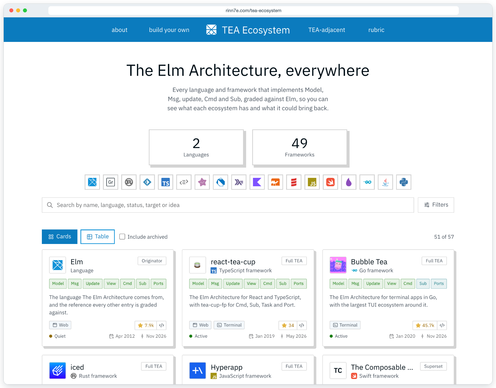

<p align="center">
  
</p>

<h1 align="center">TEA Ecosystem</h1>

<p align="center">
  <a href="https://rinn7e.com/tea-ecosystem/"><b>rinn7e.com/tea-ecosystem</b></a>
</p>

<p align="center">
  Every language and framework that implements The Elm Architecture, graded against Elm.
</p>

<p align="center">
  <a href="https://github.com/rinn7e/tea-ecosystem/actions/workflows/pages.yml"></a>
  <a href="https://rinn7e.com/tea-ecosystem/"></a>
  <a href="https://github.com/vankeisb/react-tea-cup"></a>
  <a href="https://github.com/sponsors/rinn7e"></a>
  <a href="LICENSE"></a>
</p>

A catalog of The Elm Architecture across languages: every language and framework that implements Model, Msg, update, Cmd and Sub, graded against Elm, so you can compare what each ecosystem has and what could come back to Elm.

<p align="center">
  
</p>

The site has:

- **Catalog**: 95 entries in 27 languages, as cards or as a table of grades, filtered by tier, target, status and search, and sorted by popularity, by dates or by the day an entry was added, with a New button that shows the newest entries first and a Default button that leads back. A filter that also matches archived entries, or entries of the TEA-adjacent list, says so and links to them.
- **A page per framework**: its grade on each part of TEA, with notes, and the other entries in its languages from both lists.
- **Rubric**: what counts as TEA, the four grades and the three tiers.
- **TEA-adjacent**: libraries that share the vocabulary but miss a hard requirement (Redux, NgRx, re-frame, ...), graded the same way and shown with the same listing as the catalog, filtered by what they lack.
- **Build your own TEA**: a runtime in eight steps, in Swift, TypeScript and Kotlin.

The thinking behind it is in [doc/analysis.md](doc/analysis.md).

## Stack

React with [react-tea-cup](https://github.com/vankeisb/react-tea-cup) (The Elm Architecture for React), `tea-cup-fp`, `fp-ts`, `io-ts`, Vite, TypeScript, Tailwind CSS v4, and Vitest with fast-check for property tests. Frontend only: the data is bundled at build time, and the site is static on GitHub Pages.

## Run it

The `@rinn7e` packages come from GitHub Packages, so `~/.npmrc` needs a token that can read packages:

```bash
//npm.pkg.github.com/:_authToken=<token>
```

Then:

```bash
pnpm install
```

```bash
pnpm dev
```

The site runs on `http://localhost:5180`.

## Check it

```bash
pnpm run check && pnpm run lint && pnpm run format:check && pnpm run test
```

```bash
pnpm run build
```

## Add or fix a framework

Edit `data/frameworks.json` (or `data/adjacent.json` for a library that misses a hard requirement). Give it the time you add it as `discoveredAt` (`YYYY-MM-DDTHH:MM:SSZ` in UTC, so the entries of one day sort newest first; a new entry shows as "Recently added" for 30 days), its `repo` (the full URL of its public repository, on GitHub, GitLab, Codeberg or another Gitea; only when its source is not public, its website instead, with the same URL in `website`), its `website` when it has one apart from the repository, its `source` when it is one package of a monorepo (the full URL of its directory in `repo`), and run `GITHUB_TOKEN=<token> node scripts/fetch-repo-stats.mjs` to fill its stars and its created and updated dates (after that, the stats of every entry refresh every week on their own: `.github/workflows/refresh-stats.yml` runs the same script, follows a repository that moved, commits the data when `pnpm run test` passes, and lists in its job summary what is left for a person: a status to check, a host that did not answer, a broken link, a link that redirects); a logo goes in `public/logo/` and is named in `logo`. Each grade is `native`, `managed`, `equivalent` or `missing`; the [rubric](doc/analysis.md#3-inclusion-rubric) says what each means (`equivalent` describes a part and never qualifies a tier). A superset names what it adds beyond TEA in a note that starts with `Superset: `; a TEA-adjacent library starts its notes with the requirements it misses (`Misses Cmd and Sub: ...`). An entry whose author says it is no longer maintained, though its repository is not archived, is `archived` with `unmaintainedNotice` set to where the author says so. `pnpm run test` checks that the file decodes and that every entry holds the rules of its tier.

## New entries every week

Every Monday, `.github/workflows/discover.yml` runs an AI agent (`scripts/discover-agent.mjs`, on the Claude Agent SDK) that searches for TEA frameworks the catalog does not list yet, as `.github/discover-prompt.md` says. It grades each candidate from its own docs and source, and opens one draft pull request for the week (three candidates at most) that adds their entries with the evidence of each grade. Only the data the agent wrote leaves its run: the workflow checks it and makes a commit of its own of it, and the pull request shows each new entry as code and links to the report of the run. It merges on its own when every candidate passes the rules of `scripts/judge-discovered.sh`: at least 5 stars, pushed to in the last year and not archived, every grade verified, and an example of at most 90 lines with its source. Otherwise it stays a draft, with a comment that names the rules that failed, for a person to review and merge. To settle an open pull request of the search by hand (one opened before these rules, or one a person edited), start the workflow "Settle discovered" (`.github/workflows/settle-discovered.yml`) with its number: it runs the same checks and rules, then merges it or comments. While that pull request is open, the next runs skip their search and spend nothing, so two pull requests never conflict. It skips what either data file lists, forks, archived, unmaintained and tiny projects, and the projects of `data/rejected.json`.

To see what the agent did, open the run in the Actions tab (workflow "Discover"): the step that runs the agent prints one line per step as it happens (each search, fetch, edit and command, each call it was denied, each call that failed, each retry of the API, and a short line for each thing it says), so the log can be followed live; the report of the agent is in the summary of the run (or, for an agent that did not finish, why, and what it said last); and the full transcript (every message, call and result) is the artifact `discover-transcript-<try>` of the run (`discover-transcript-1`, and one more for each re-run), kept 7 days, also when the agent failed or timed out. Any signed-in GitHub user can download the artifacts of a public repository, so the script writes the API key and the tokens into the transcript and the log as `***`.

To turn a candidate down, remove its entry and its example from the pull request, and add its repository to `data/rejected.json` in the same pull request, with the day and the reason, so it is never proposed again, then run `pnpm run test` on the branch before merging (no check runs on a pull request); to turn them all down, close the pull request and add each one to `data/rejected.json` on `master`:

```json
{
  "repo": "https://github.com/<owner>/<name>",
  "rejectedAt": "2026-11-16",
  "reason": "A fork of an entry, with no change to its loop."
}
```

`pnpm run test` checks the file, and that no project is both listed and turned down. The workflow runs with the repository secret `ANTHROPIC_API_KEY`, and needs GitHub Actions allowed to create pull requests (Settings, Actions, General).

## Deploy

`.github/workflows/pages.yml` checks, builds and publishes `dist/` to GitHub Pages on every push to `master`, and after every weekly refresh of the stats that commits new data (`refresh-stats.yml` starts it, since a push made with the `GITHUB_TOKEN` of a workflow starts no workflow). The site is served under `/tea-ecosystem/` (`.env.production`); the build copies `index.html` to `404.html` so a deep link opens the app. The built site counts visits with Cloudflare Web Analytics (no cookies, no personal data), added by the build only (`vite.config.ts`), so the dev server is never counted.

## Contributing

Corrections and new entries are welcome: see [CONTRIBUTING.md](CONTRIBUTING.md) for how to report one and how to pick up an issue.

## License

MIT
