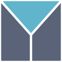
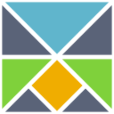
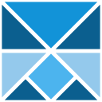
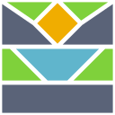
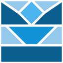
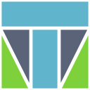
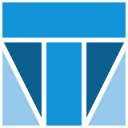
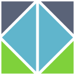
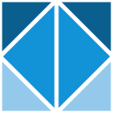

# Emblem variants

Each emblem is a square cut into pieces, after the spirit of the Elm logo but with our own cuts, mirrored on the vertical axis. They were drawn on 2026-11-13 with the maintainer's own tooling; the site uses `b-tangram` for now (style guide, section 7), and the others stay here until the final logo is decided.

Every cut comes in four colorings:

- `-elm`: the four colors of the Elm logo, on transparent.
- `-site`: the blues of the site (`#1293D8`, `#0B5F8F`, `#94C9EC`, `#4CB4EE`), on transparent.
- `-mono`: every piece white, on the bar blue `#0B7BBE`.
- `-accent`: white on the bar blue, the key pieces full and the rest at half opacity.

| Cut         | Pieces                                                                                  | Elm colors             | Site blues              |
| ----------- | --------------------------------------------------------------------------------------- | ---------------------- | ----------------------- |
| `a-three`   | Split like a Y: a V-shaped cup on top and two sides holding it, for Model, view, update |    |    |
| `b-tangram` | A big triangle (a cup) over a diamond (its foot), with triangles around them; in use    |  |  |
| `c-cup`     | A tea cup cut from the square: a diamond of steam, a bowl with 45 degree sides, a base  |      |      |
| `d-t`       | A T for TEA: the bar and the stem, each side below cut on its diagonal                  |        |        |
| `e-diamond` | A diamond cut in half on the axis, with the four corners around it                      |  |  |

Recolorings of `b-tangram`, drawn after its `-site` coloring read as a face in the favicon (two darker triangles beside the axis looked like eyes). The favicon uses `f2`.

| File                               | Coloring                                                                             | Preview                               |
| ---------------------------------- | ------------------------------------------------------------------------------------ | ------------------------------------- |
| `b-tangram-f1-hourglass.svg`       | The cup and its foot dark, every side piece one mid blue                             |        |
| `b-tangram-f2-hourglass-light.svg` | The cup and its foot bright blue, every side piece light blue; in use as the favicon |  |
| `b-tangram-f3-light-over-dark.svg` | Light above, dark below, like a cup on a table                                       |  |
| `b-tangram-f4-halves.svg`          | The top half one blue, the bottom half a darker one, the diamond bright              |           |
| `b-tangram-f5-one-blue.svg`        | Every piece one blue                                                                 |         |
